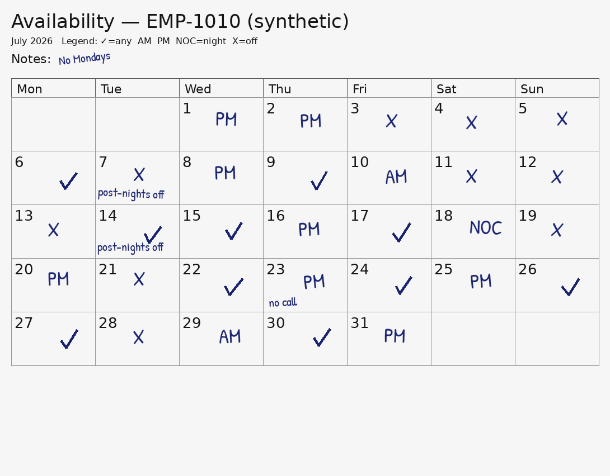
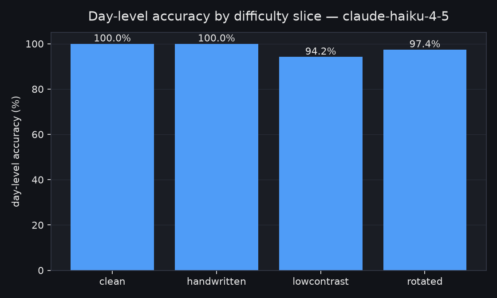
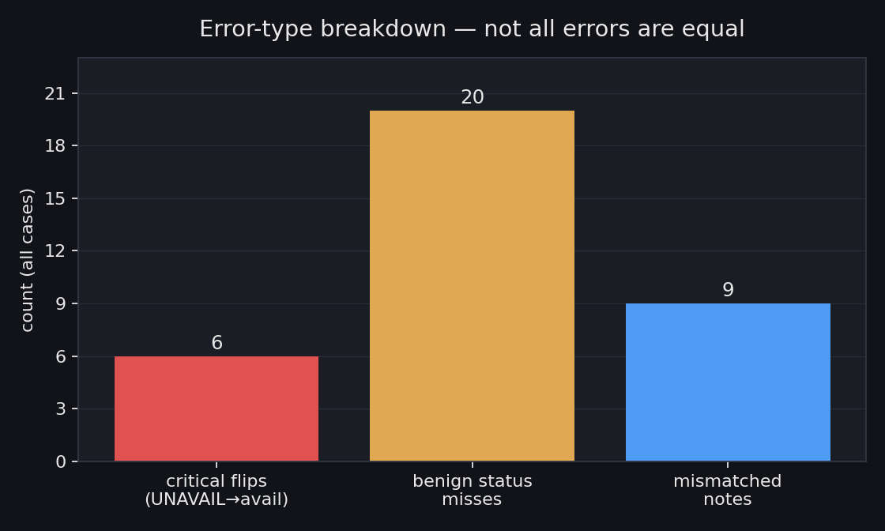

# ED Availability Intake — an LLM Extraction Eval
A documented, synthetic-data evaluation of how accurately a vision LLM turns a filled-in staff-availability calendar into structured scheduling data. Clinical safety and deployment outcomes were not evaluated.

   

**Author:** Galen Coulter-Ledbetter, RN, Paramedic · working ED nurse · Paramedic licensure held in Florida · military medical education and readiness leadership · daily multi-EHR and clinical-AI user.

| The input | The question |
|---|---|
|  | A nurse prints a blank month, hand-marks availability, snaps a photo, and emails it. Before any scheduler can use that, something has to **read it correctly**. When an LLM does the reading and gets it wrong — **which fields are wrong, and how should the errors be counted?** |

---

## Current simulation edition

The 2026-11-03 scope amendment adds a finite, paired simulation study: twelve fictional calendars, each rendered as typed text, handwriting-font text and a degraded version of that same handwriting image. All four month lengths and four licensed handwriting fonts are included. Blank availability marks have an explicit NOT_SPECIFIED meaning. The plan, truth, prompt, scorer and image bytes were frozen before model calls.

The completed local-model simulation collected 36/36 first observations. Strict exact-calendar recovery was 4/12 typed, 3/12 handwriting-font, and 3/12 degraded-handwriting calendars. The simulation edition has its own completion scope. The preserved original human photograph/intent study is future work outside this edition; generated fonts do not stand in for human-study evidence.

- [Simulation study and results](docs/SIMULATION-STUDY.md) · [Written report](paper/SIMULATION-PILOT.md) · [PDF](paper/SIMULATION-PILOT.pdf)
- [Frozen simulation data and reproduction](simulation/README.md) · [Prospective plan](simulation/PLAN.md)
- [Software release and study scope](docs/RELEASE-STATUS.md) · [Historical technical report](paper/TECHNICAL-REPORT.md)
- [Historical numerical source map](docs/NUMERICAL-SOURCE-MAP.json) · [Simulation numerical sources](simulation/NUMERICAL-SOURCES.json)

The current simulation schema uses AVAILABLE, AM, PM, NIGHT, UNAVAILABLE and NOT_SPECIFIED. A blank mark means NOT_SPECIFIED. Every true date is required, and notes are exact matches. See [the frozen prompt](simulation/PROMPT.txt) and [strict scorer](simulation/score_simulation.py). The older five-status schema and normalized-note metrics below describe the historical benchmark only.

The historical model names below are the exact labels in saved records; provider execution identity was not independently authenticated during the earlier repair. Historical metrics and the new simulation use different designs and scoring rules and must not be pooled.

## Try the software without a model

```sh
python -m pip install -r requirements.txt
python -B tools/run_checks.py
```

These checks use saved public data and synthetic responses, including temporary local HTTP fixtures. They do not call a model service. Missing private/reference evidence is printed as UNVERIFIED. See the [release review](docs/RELEASE-REVIEW.md) for the independently checked scope.

## Historical results

**Historical record: scored 2026-08-13 · Anthropic API · single run per recorded model · all 40 cases · zero format retries. This repair did not independently authenticate the original service execution.**

**UNAVAILABLE-to-available status errors.** `claude-sonnet-5`: **0 critical flips across 316 gold-UNAVAILABLE days (0.0%)**. `claude-haiku-4-5`: **6 flips across the same 316 days (1.9%)** — all six on degraded slices (5 lowcontrast, 1 rotated), peaking at **5.7%** on lowcontrast.

| Metric (overall, 40 cases) | claude-sonnet-5 | claude-haiku-4-5 |
|---|---|---|
| **Critical-error rate** (UNAVAILABLE→available) | **0.0%** (0 / 316) | **1.9%** (6 / 316) |
| Day-level accuracy | 100.0% (1240 / 1240) | 97.9% (1214 / 1240) |
| Note **displacement** rate (v1 called this "hallucination rate" — see [`analysis-v2.md`](analysis-v2.md) §A3) | 0.7% (1 / 147) | 6.2% (9 / 145) |
| Note **fabrication** rate (text absent from the page) | 0.0% (0 / 147; Wilson 95% upper 2.5%) | 0.0% (0 / 145; upper 2.6%) |
| Note fidelity (normalized match) | 100.0% (146 / 146) | 93.2% (136 / 146) |
| Format validity | 100.0% | 100.0% |
| **Documents with a status error** | **0 / 40** (Wilson upper 8.8%) | **9 / 40 = 22.5%** [12.3%, 37.5%] |
| **Documents with ANY status or note error** | **1 / 40 = 2.5%** | **12 / 40 = 30.0%** [18.1%, 45.4%] |

> **The last row counts documents with any status or note error.** The row above it counts status errors only. Rates indexed on *predicted* notes use 147 and 145 as denominators; rates indexed on *gold* notes use 146. Those are different questions. See [`docs/METHODS.md`](docs/METHODS.md) §5.

> ### 📄 Read [`docs/CORRECTIONS.md`](docs/CORRECTIONS.md) first.
> One of the metrics in the table above was named for a failure it did not measure. The correction is public and `v1.0.0` is preserved as a tag so the two can be read side by side.

Per-slice breakdowns: [`results/summary.md`](results/summary.md) (Sonnet) · [`results_haiku/summary.md`](results_haiku/summary.md) (Haiku). Row-level data in each folder's `per_case.csv`.

**The saved Sonnet run reached 100% day-level accuracy on this benchmark.** Every slice, including the synthetic handwritten slice, had 100% status accuracy. Its only recorded error in 40 cases was a duplicated note: the "charge only" annotation from July 2 was also asserted on July 1, whose cell has no note (`sample_01_clean`). This result describes **one recorded model configuration on one date** and motivates a harder evaluation tier.

**Haiku's failures are mostly geometric, not glyphic.** Its handwritten slice is perfect; the errors cluster in spatial indexing. Worst case: a one-day grid shift on a faint calendar (`sample_11_lowcontrast`) misread 9 days and produced 3 phantom-available days in a single document. Under rotation, notes landed exactly one week-row down (`sample_02_rotated`: "no call" 18th→25th, "early out" 24th→31st). The notable failures are traced case by case in [`analysis.md`](analysis.md). Raw model output is not shipped; see [`docs/METHODS.md`](docs/METHODS.md).

<p> </p>

---

## The asymmetric status error
Not all misreads have the same meaning. Reading `AM` as `PM` changes a stated shift; reading **UNAVAILABLE as available** creates availability the person did not provide. If that error escaped human review and downstream scheduling checks, it could affect a schedule. This evaluation did not test that pathway or measure prevention and correction costs. The `UNAVAILABLE → available` flip is the evaluation's **critical-error rate**, reported separately from ordinary accuracy to expose this particular error. The earlier patient-safety framing was withdrawn because no clinical deployment or safety outcome was measured; see [`docs/CORRECTIONS.md`](docs/CORRECTIONS.md) §5.

## Historical extraction task and schema
**Input:** an image of a filled-in monthly availability calendar.
**Output:** structured JSON.

```json
{
  "month": "2026-07",
  "days": {
    "2026-07-01": { "status": "PM", "note": "" },
    "2026-07-02": { "status": "UNAVAILABLE", "note": "no call" }
  },
  "global_notes": ["No weekends"]
}
```
`status ∈ {AVAILABLE, AM, PM, NIGHT, UNAVAILABLE}` (AVAILABLE = any shift). Calendar legend: `✓=any  AM  PM  NOC=night  X=off`.

*Schema note:* the rendered calendars carry a synthetic employee ID as visual decoration. It is recorded in each gold file but never scored, so it is deliberately **not** in the required output schema. Stated here because silently dropping it would be the kind of drift an eval exists to catch.

## Historical synthetic dataset
`generate_dataset.py` *generates* each availability pattern first, then renders it to an image — so every calendar ships with its **exact** ground-truth JSON. No manual labeling and no real records — a staff availability calendar carries employment data, not patient data, and every calendar here is generated, and the whole 40-case dataset is **regenerable from a single seed** (`--seed 7`). *Byte-identical* output additionally requires the same Pillow/FreeType build — glyph rasterisation for the handwritten slice varies across versions and platforms — so `requirements.txt` pins Pillow and byte-identity is claimed only for a matching environment. Rendering conditions are varied in descriptive slices. Content changes with the condition, so slice differences cannot isolate a rendering effect:

| Slice | What it simulates |
|---|---|
| `clean` | typed codes, straight scan |
| `rotated` | photographed at an angle |
| `lowcontrast` | faint scan / poor lighting |
| `handwritten` | pen-filled printed calendar — handwriting font, per-mark jitter, stroke-drawn check marks |

## Historical metrics and rubric
Per case, then aggregated per slice and overall:
1. **Day-level accuracy** — % of days with correct `status`.
2. **Critical-error rate** *(headline)* — `UNAVAILABLE → available-of-any-kind` flips, per gold-UNAVAILABLE day.
3. **Note mismatch rate** — predicted notes that differ from that day's gold note. Since v1.2 the harness also splits them: **displaced** (the text is a gold note of the calendar, at another place) and **fabricated** (the text is no gold note), in `per_case.csv` and `metrics.json` → `typed_notes`. *(v1 named this "hallucination rate" and defined it as text not on the page. The typed re-score in [`analysis-v2.md`](analysis-v2.md) found **every** counted note was on the page, a displacement, which is why the results table reports it as the displacement rate. Fabrication is reported separately, over *predicted* note instances: **0 / 147** for Sonnet and **0 / 145** for Haiku (Wilson 95% upper **2.5%** and **2.6%**; 0 / 292 pooled across both models, upper 1.30%).)*
4. **Note fidelity** — gold notes captured (normalized match; optional `--judge` adds an LLM-as-judge pass, reported separately, bias acknowledged).
5. **Format validity** — parsed, schema-conforming (exactly the prompt's fields, all days present, statuses in enum, notes as strings), counted over cases that produced a model answer. Since v1.2 an invalid response is **reported and not scored**: the other rates use scored cases only, and `summary.md` prints the invalid count. A provider error is counted separately and never as a model answer.
6. **Robustness delta** — accuracy on `clean` minus each degraded slice.

## Run the historical software
Python 3.11+ with **Pillow** (`pip install -r requirements.txt`); matplotlib only for charts. Current dependencies include security fixes and differ from the historical rendering environment. Use the committed images for the historical benchmark; a new render is not claimed to be pixel-identical. Extraction never sees gold labels. Scoring never calls the API unless the optional `--judge` flag is set; no published result uses it, and when it is set the judge sees the gold note. Credentials are supplied through environment variables. The transports redact exact credential echoes and reject reflected successful responses before scoring. See [SECURITY.md](SECURITY.md) for the input and privacy boundaries.

```bash
python3 generate_dataset.py --n 40 --seed 7     # rebuild the dataset (or use data/ as shipped)

export ANTHROPIC_API_KEY=...                     # or OPENAI_API_KEY for gpt-* models
python3 run_eval.py --model claude-sonnet-5 --limit 4   # cheap sanity run first
python3 run_eval.py --model claude-sonnet-5             # full 40-case run
python3 run_eval.py --model claude-haiku-4-5 --out ./results_haiku   # second-model run, as published
python3 run_eval.py --model gpt-4o                       # provider inferred from model string (claude*, gpt*, o<N>*; other names are refused before any call)

python3 make_charts.py                           # renders results/charts/*.png
python3 make_charts.py --results ./results_haiku # charts for the second-model run
```
Outputs: `results/metrics.json` (aggregates), `results/per_case.csv` (row-level), `results/summary.md` (README-ready table), `results/run_status.json` (COMPLETE / INCOMPLETE / FAILED, with the exit code), `results/raw/` (raw model output per case, gitignored). A rerun first moves the previous run's outputs to `results/_previous/<UTC time>/`; nothing is deleted, and `.gitignore` keeps the archived raw output out of commits too.

Exit codes: `0` complete with at least one scored case · `1` no model answer (FAILED) · `2` usage or configuration error, refused before any call · `3` incomplete (provider errors, answers cut off at the token limit, or cases not run) · `4` every answer invalid, nothing scored. An answer cut off at the token limit is saved as `raw/<case>.truncated.txt` and is never scored.

How to verify, without an API key or a model call:
```bash
python3 tests/test_harness.py                       # exits 0 only if every check ran and passed
python3 tests/test_harness.py --allow-unverified    # a public checkout: re-scoring needs the gitignored raw responses
```

*Cross-provider note:* the Anthropic path is exercised in the published run. **The OpenAI path is implemented to spec and untested** — it has never been executed. The probe as first registered made its CLOSE branch depend on it; [`docs/PROBE-AMENDMENT-01.md`](docs/PROBE-AMENDMENT-01.md) retires that branch. No photograph-probe result is reported here. The OpenAI path will be exercised on a small case set before any published result relies on it.

## Failure modes watched for
AM/PM/NOC confusion · date–cell misalignment (off-by-one weeks) · ambiguous-mark misreads · skew/rotation drops · faint-mark omissions · handwriting misreads · note truncation · invented notes. Each observed failure gets a concrete case in [`analysis.md`](analysis.md) with the **operational consequence stated in staffing terms**.

## Proposed guardrails (the clinician's recommendations)
Per-day confidence scores routing low-confidence cells to human confirm · **employee e-confirmation** of the parsed result before it enters the scheduler (closes the loop on the dangerous flip) · schema + sanity validators (reject a parse that marks a whole month AVAILABLE) · re-prompt or second-model vote on low-confidence cells.

## Why an eval, not just a demo
A working tool proves *"I can build."* An eval demonstrates how to define a task, measure observed errors, and explain the limits of those measurements. Those skills are relevant to clinical-AI review and validation roles; this artifact does not establish clinical safety. The transferable part is the measurement discipline — typed error classes, denominators, chance floors, pre-registered decision rules, and a published account of where the instrument was wrong. **The extraction task is narrower than general clinical document intake:** a fixed 31-cell grid with a five-symbol closed vocabulary and machine-generated ground truth, against unbounded layouts, open vocabulary, real PHI and human-adjudicated labels.

## Product vision (what this is the front door of)
A possible future project is an ED scheduling system that ingests availability in whatever form it arrives, maps the scheduling period, projects daily assignments, adapts to callouts / census swings / travel-contract turnover / orientation double-assignments, and surfaces holes before they happen. That's a constraint-optimization + integration build. **This eval measures transcription errors in a bounded synthetic intake task** — an optimizer fed bad intake produces confidently wrong schedules.

## Limitations
> **Fuller treatment: [`docs/LIMITATIONS.md`](docs/LIMITATIONS.md)** — including the two that matter most: one stored configuration reaches **100% status accuracy** (that ceiling cannot establish rankings among other or current models), and slice comparisons **confound rendering with content** by construction (`seed = 7 + i`, `style = i % 4`).

Synthetic calendars — even the handwritten slice — are cleaner and more uniform than real-world artifacts; performance on real photographs is **unknown**, and these results do not define a mathematical upper bound. There is one run per recorded model and no run-to-run variance estimate. The optional LLM-as-judge uses the model under test itself; no published result uses that option. The rubric has one author.

## Repo layout
```
ed-availability-intake-eval/
├── README.md
├── LICENSE                # MIT (bundled font: SIL OFL 1.1, see assets/fonts/OFL.txt)
├── generate_dataset.py    # synthetic calendars + ground-truth JSON (seeded, reproducible)
├── run_eval.py            # extraction harness + scoring (Anthropic | OpenAI)
├── make_charts.py         # results charts (matplotlib)
├── assets/fonts/          # Patrick Hand (OFL 1.1) for the handwritten slice
├── data/                  # 40 generated images + .gold.json (regenerable)
├── results/               # claude-sonnet-5 run: metrics.json, per_case.csv, summary.md, charts/
├── results_haiku/         # claude-haiku-4-5 run: same layout
├── V2_TIER_DESIGN.md      # next difficulty tier (v1 frozen; Sonnet saturated it)
├── analysis.md            # failure-mode writeup traced to per_case.csv rows
├── analysis-v2.md         # metric audit: typed error split, corrected Finding 2, calendar-level CIs
├── typed_errors.json      # per-model totals for every error type
├── calendar_level.csv     # per-calendar rates and uncertainty
├── requirements.txt
└── docs/                  # METHODS · CORRECTIONS · LIMITATIONS · PROBE (pre-registration)
```

## Roadmap
- [x] Spec + synthetic generator
- [x] 40-case dataset across 4 difficulty slices (incl. handwritten)
- [x] Extraction + scoring harness, dual-provider
- [x] Scored run + charts (claude-sonnet-5 + claude-haiku-4-5, 2026-08-13)
- [x] Failure-mode analysis + guardrails (`analysis.md`)
- [x] **Metric audit and correction** — `analysis-v2.md` + `docs/CORRECTIONS.md` (2026-09)
- [x] **Methods, limitations and a pre-registered probe** — `docs/` (2026-09)
- [ ] Run-to-run variance check
- [ ] v2 difficulty tier — Sonnet saturated v1 (design: `V2_TIER_DESIGN.md`)
- [ ] Automated harness search over this eval — can an optimized harness close the Haiku→Sonnet gap? (candidate method: Meta-Harness; no affiliation with its authors)

**Independence:** developed on personal time and personal equipment. No employer data, systems, or resources were used, and no employer is identified. Views are the author's own.

---
*The benchmark dataset is 100% synthetic — no PHI, no employer data, no real schedules — **by construction.** Arm B of the probe ([`docs/PROBE-B.md`](docs/PROBE-B.md)) scores the author's **own** real availability documents; those images never enter this repository and only derived numbers do — **by policy, and stated as such.***
