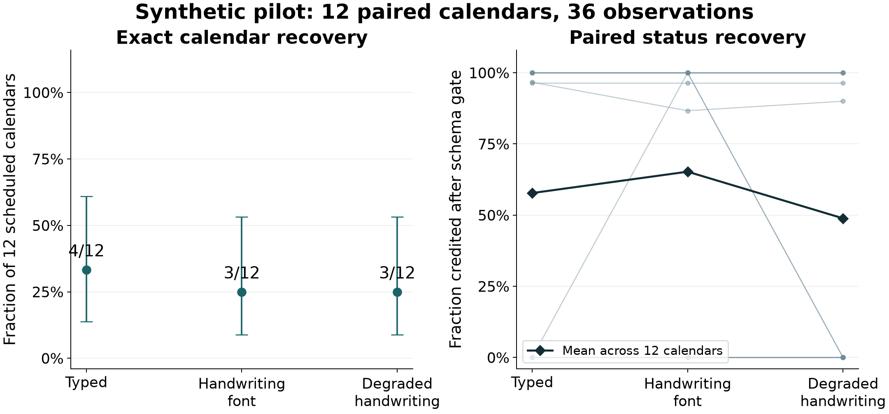

# A paired synthetic calendar extraction pilot

**Completed simulation edition.** Concept and scope: Galen Coulter-Ledbetter. Software implementation, execution analysis and report drafting: AI-assisted, with separate review. This authorship statement does not claim human participation in the generated dataset.

This study evaluates extraction from fictional availability calendars using typed and handwriting-font images. It is a controlled software pilot. Font rendering is not human handwriting, a phone photograph, or an observation of a person's intent. The original human-study evidence and unfinished endpoints remain preserved separately.

## Design and data

Twelve latent calendars were selected with fixed seed 2026110301 from years 2024–2032, stratified to include three months each with 28, 29, 30 and 31 days. Each latent calendar produced a typed control, a handwriting-font image and a degraded version of that same handwriting image: 36 images containing 354 date cells per condition and 1,062 rendered date cells overall. Conditions are paired by latent calendar. Padding cells are not dates and are never scored as dates.

Each calendar contains all six allowed availability statuses, five invented day notes and two invented global notes. A visible legend defines blank marks as NOT_SPECIFIED. An X means UNAVAILABLE. There are no real staff, patient records, personal signatures or real staffing decisions. Patrick Hand, Caveat, Kalam and Handlee were each assigned to three calendars. Font binaries, licenses and source hashes ship with the dataset; typed text uses bundled DejaVu Sans. Calendar geometry is constant across typed and handwritten conditions. Font size and per-mark jitter are part of the composite handwriting rendering condition, so the comparison does not isolate font shape alone.

The degraded image is derived from the matched handwritten image, with reduced resolution, contrast, slight blur and a small rotation. It represents those fixed synthetic image transformations; it does not claim to reproduce the distribution of real phone photographs. Exact transformation parameters, source bytes and all generated inputs are hash-bound by FREEZE.json. No outcome-driven fixture adjustment or prompt tuning is allowed.

## Model procedure

Orca controller execution supplies one image and the identical extraction prompt per request. Opaque request identifiers and randomized order do not expose condition, latent month or gold labels to the model. The gold and pairing manifest remain outside model requests. Model identity, effective settings, ownership checks and actual request timing belong in the execution record. The prospective contract requests temperature zero and an output limit of 4,096 tokens. Unsupported settings must be disclosed. The first observation is primary; failures and truncation are retained, and any retry is a separately recorded deviation.

The recorded provider model label is `unsloth/NVIDIA-Nemotron-3.5-Bolt-E4B-GGUF`. All 36 scheduled first observations were collected. Outcome counts: `{"response": 36}`; finish reasons: `{"stop": 36}`. The summed native generation-step time was 212.27 seconds across 36 timed observations; this is not total study wall time. The selected BF16 weights and vision projector are identified by SHA256 in EXECUTION-SUMMARY.json. Effective execution settings and any deviations are documented in the execution appendix.

## Scoring and analysis

Primary success is exact calendar recovery: strict valid JSON, correct month, every true date/status/note and the exact ordered global-note list. The schema refuses duplicate keys, nonfinite numbers, unsupported statuses, impossible dates, padding dates, missing fields and extra fields. Notes are compared exactly without trimming or case folding. Invalid, missing, refused, truncated or wrong-month responses fail the primary endpoint and receive no secondary cell credit. Critical flips are counted only in scorable responses; unscorable responses have an unknown flip count, not a claim of safe zero errors.

Secondary summaries include exact status and note accuracy, note-bearing-date accuracy, strict schema validity and unavailable-to-available flips. Calendar clusters, not individual cells or repeated renders, are the independent units. Per-condition exact-calendar fractions have Wilson 95% descriptive intervals. Three within-calendar comparisons use handwriting minus typed, degraded minus handwriting and degraded minus typed. Mean paired differences in exact-calendar success and status accuracy have deterministic 95% percentile bootstrap intervals from 10,000 resamples of the 12 calendar clusters. These intervals describe this small convenience design; they do not establish population-wide coverage or clinical reliability. Degenerate intervals are identified.

## Results

All 36 scheduled first observations remain in the analysis. Strict calendar success requires the complete date/status/note/global-note contract, so a response can preserve every status yet fail exact recovery because a note differs.

| Condition | Exact calendars /12 | Wilson 95% descriptive interval | Credited statuses /354 | Credited note-bearing dates /60 | Unscorable calendars |
|---|---:|---:|---:|---:|---:|
| typed | 4/12 | 13.8%–60.9% | 203/354 | 35/60 | 5 |
| handwriting | 3/12 | 8.9%–53.2% | 231/354 | 40/60 | 4 |
| degraded | 3/12 | 8.9%–53.2% | 173/354 | 30/60 | 6 |

Figure 1. Left: exact-calendar fractions and Wilson 95% descriptive intervals, denominator 12 per condition. Right: each line follows one latent calendar; dark diamonds show the mean status fraction across 12 calendar clusters. Failures receive zero recovery. Cells and repeated renders are not independent samples.

| Paired comparison | Exact-calendar difference, percentage points [95% descriptive interval] | Mean status difference, percentage points [95% descriptive interval] |
|---|---:|---:|
| handwriting minus typed | -8.3 [-25.0, 0.0] | 7.5 [-2.5, 25.0] |
| degraded minus handwriting | 0.0 [-25.0, 25.0] | -16.4 [-41.4, 0.6] |
| degraded minus typed | -8.3 [-25.0, 0.0] | -8.9 [-26.1, 0.0] |

There were 26 non-exact calendars. Extraction-failure categories: `{"invalid_json_or_schema: status": 14, "invalid_json_or_schema: date set does not equal actual month": 1}`. The row-level status/note differences and failed-response categories are preserved in ERRORS.json; all raw assistant text is available with provenance hashes.

Typed: 0 unavailable-to-available flips in scorable responses; 5 unscorable calendars whose flip counts are unknown. Handwriting: 0 unavailable-to-available flips in scorable responses; 4 unscorable calendars whose flip counts are unknown. Degraded: 0 unavailable-to-available flips in scorable responses; 6 unscorable calendars whose flip counts are unknown. 

The strict schema gate rejected 15 responses: 14 used literal printed codes such as NOC, A or X where the contract required NIGHT, AVAILABLE or UNAVAILABLE; one omitted February 1, 2032. These are output-contract failures, not evidence that every rejected cell was visually misread. The prespecified analysis assigns zero cell credit to each invalid calendar and does not normalize those codes after observing the outcomes. Among the 21 scorable responses, there were 11 status mismatches and six day-note mismatches. In one handwritten May calendar, the note 'swap OK' from May 29 was also assigned to May 31. The complete case list is in FAILURE-DIAGNOSTICS.json and ERRORS.json. No repaired-output success rate is substituted for the frozen primary result.

Software verification was separate from these model observations: 11 test methods passed; 36 PNGs decoded; all 67 frozen files reproduced identically in the same environment. Known-answer and missing-observation controls verified scorer behavior and were excluded from model results.

## Execution appendix

The native request records specify temperature 0, a maximum of 4,096 output tokens and a 600-second timeout per request. Recorded load metadata identifies BF16 weights, a 32,768-token context, q8_0 KV cache, one parallel slot and an active dflash drafter. The model service reported vision enabled. The endpoint did not independently echo every sampler setting or an engine-build identifier; EXECUTION-SETTINGS.json preserves the available per-request metadata. The model snapshot is `b738967d6da3441a7d1c71fcec15e49e32e16ecd`. Public assistant text is unchanged; private paths were removed only from metadata. Rescoring the public projection produced exactly the same complete score object as scoring the original collection. No observation was replaced or retried in the primary dataset.

## Limits and interpretation

This pilot substitutes a fully disclosed simulation for the newly authorized deliverable. It cannot validate human transcription, authored-versus-copyist intent, natural handwriting diversity, real phone capture, employee consent, scheduling safety or clinical use. Four fonts and twelve calendars are a small constructed sample. The prompt gives a clear legend, notes are short, marks come from six fixed categories and degraded images use one mild transformation recipe. A single model family or local execution route cannot support cross-model generalization. Errors are informative results; high accuracy would still require separate evidence before any real-world use.

## Reproduction and provenance

The frozen package contains the prospective plan, generator, strict scorer, focused tests, all font licenses, twelve gold calendars, thirty-six images and randomized image-only request input. The base software commit is e7d4f28c00b258ff0d9c421e9e696a11840652f8. This separate edition does not change original human-study versions. A numerical-source table maps report quantities to machine-readable evidence. Actual responses are saved separately from frozen source inputs and test controls.

AI assistance was used to implement and review the software and draft this report. Actual model observations are identified separately; no synthetic test control is represented as an observed model response.
